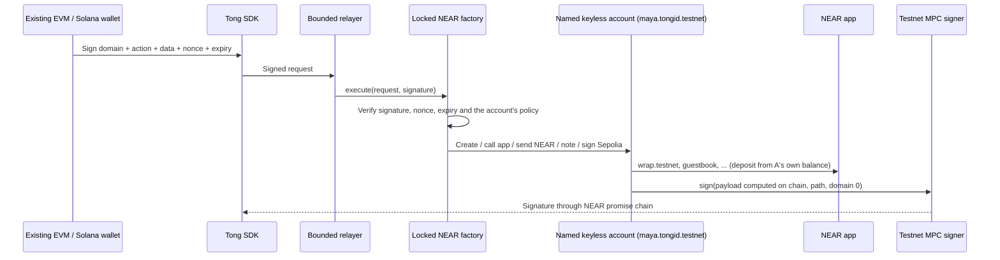

# Tong 通: your EVM or Solana wallet, a named NEAR account, limits NEAR enforces

**Tong gives your MetaMask or Phantom wallet a named NEAR account. A sponsor pays the gas, and the spending limits are enforced by the NEAR contract itself, not by an app.**

Sign one message with the wallet you already have and get `maya.tongid.testnet`, a NEAR account with zero access keys. From then on, every signed request runs through a locked Rust contract that checks:

- the signature (EIP-712 via `env::ecrecover`, or Solana ed25519 via `env::ed25519_verify`);
- a one-use nonce and a deadline of at most 5 minutes;
- your account's on-chain policy:
  - which apps and methods are allowed;
  - the per-call deposit cap;
  - when each permission expires;
  - the per-transfer cap;
  - the daily allowance.

Only then does it act. The same account can ask NEAR Chain Signatures to sign a capped Sepolia transfer.

Built during NEAR HACKATHON, November 2026. Testnet only. MIT © 2026 Nivesh Gajengi. This is a prototype, not audited wallet infrastructure.

## Why Tong, and where others are better

Several products already let an Ethereum or Solana wallet touch NEAR. Each works differently:

- **NEP-518 Ethereum accounts:** a `0x…` account that pays its own gas and has no per-action limits.
- **NEAR Intents and HOT Omni:** they verify foreign signatures for a balance inside one contract.
- **Embedded wallets:** they create a new key.
- **Function-call keys:** they need a NEAR key and allow no deposits.

Tong combines all of these in one place:

- your existing wallet;
- a readable name;
- sponsored gas;
- on-chain allowlists with caps, a daily allowance and expiry;
- Chain Signatures.

To be plain:

- NEP-518 is protocol-native and audited.
- HOT has a far larger user base.
- Privy's policy engine is more mature.

Sourced comparison: [docs/POSITIONING.md](docs/POSITIONING.md). The same table is on the landing page.

## What works today (live on NEAR testnet)

- **Named accounts:** `link {"name":"maya"}` creates `maya.tongid.testnet`. The account is deployed with the Tong account contract, controlled only by the locked factory, and has zero access keys.
- **Real NEAR apps:**
  - wrap and unwrap NEAR on `wrap.testnet`;
  - post to the NEAR Guestbook (`guestbook.near-examples.testnet`);
  - send NEAR to any account.
  
  Deposits come from your own account; the sponsor pays only gas.
- **On-chain policy:**
  - Default grant: `wrap.testnet` (`near_deposit`, `near_withdraw`), at most 0.2 NEAR per call, valid for 30 days.
  - Send cap: 0.1 NEAR per transfer.
  - Daily allowance: 0.3 NEAR.
  - Apps add grants with a signed `grant`, at most 1 NEAR per call and 30 days. `revoke` removes them.
  - The relayer does **not** pre-filter policy, so over-limit and unpermitted calls are refused **on chain**, with a receipt.
- **Chain Signatures:** the named account is the MPC predecessor. It builds a capped EIP-155 Sepolia transaction on chain and gets a real signature from `v1.signer-prod.testnet`.
- **Developers:**
  - `@tong/sdk`: `connect`, `link(name)`, `call`, `sendNear`, `grant`, `revoke`, `signSepolia`. Refusals throw `{ refused, txHash }`.
  - A React hook and stdio MCP tools.
  - `#/demo`, a separate Guestbook dApp built in six SDK lines.
- **Live 1Click mainnet dry quote:** no deposit address is requested and nothing is signed.

The Sepolia transfer is **signed, not broadcast**: derived addresses hold no Sepolia test ETH ([BLOCKED.md](BLOCKED.md)).

Not supported yet:

- WalletConnect mobile transport;
- recovery;
- a hosted relayer;
- outbound chains other than Sepolia.

## Inspect the live proof

v2 factory: [`tongid.testnet`](https://testnet.nearblocks.io/address/tongid.testnet), deployed in [DBDzGrsX…](https://testnet.nearblocks.io/txns/DBDzGrsX3nZbXQ5zUfKsXjbxnfet5CU4FEhJg2arcnqQ). The film's own transactions (account `mira.tongid.testnet`, including the on-chain refusal [GiLBrQn7…](https://testnet.nearblocks.io/txns/GiLBrQn7U2V3ivUQwHpMWsJEX7QhUJjrLsYtkFMqyN5p)) are listed in [FLOW-QA.md](FLOW-QA.md). Factory locked in [H6cmi5CA…](https://testnet.nearblocks.io/txns/H6cmi5CALSeEFywLVwPeSBQY9QJ2rocPbSnsWJNWMa12): zero access keys.

| Evidence (v2 rehearsal, Nov 14) | Result |
| --- | --- |
| [Named account created](https://testnet.nearblocks.io/txns/A7maKkNgV6Rbys3Y1W43qfkP5i1Aop5EYK4DqEKRGBsz) | `rehearsal-7u589.tongid.testnet`, zero keys |
| [Wrap 0.1 NEAR on wrap.testnet](https://testnet.nearblocks.io/txns/HLkyVk8D24BN1zaj9oM3TgPEbzxVaZpffitkqAHfzA2f) | 0.09875 wNEAR (0.00125 NEAR went to wNEAR storage) |
| [Wrap 0.5 NEAR: refused](https://testnet.nearblocks.io/txns/CGc1uAArvQzQiJbqNzuf85Pdknpy4xxye6ZZgusC4pSV) | `policy: 0.5 NEAR is over the 0.2 NEAR per-call limit for wrap.testnet` |
| [Guestbook before a grant: refused](https://testnet.nearblocks.io/txns/5MftM3q4GCfNtgPn3TusKpqKzE3M3MN2kpCYmCtN6LxZ) | `policy: no permission for guestbook.near-examples.testnet` |
| [Grant the Guestbook](https://testnet.nearblocks.io/txns/H8btJuxGAvxNR71d9CwRopTR7baXfcUPVBwKQG1YAVqJ) | `add_message`, no deposit, 7 days |
| [Guestbook message](https://testnet.nearblocks.io/txns/2wd1PhafVv16ggLgjQAy1wrTQ5bwQXQvkNPdjFWmfYjX) | Posted from the named account |
| [Send 0.05 NEAR](https://testnet.nearblocks.io/txns/5muqUPm6U7jrZrpLG4eVHpn1ghFGjR1LeBUsZoRGkTps) | From the account's own balance |

Evidence files:

- [deployments/v2/rehearsal.json](deployments/v2/rehearsal.json): the full policy state after the rehearsal.
- [deployments/v2/relayer-topups.json](deployments/v2/relayer-topups.json): testnet faucet top-ups.

The v1 factory `tong-d8l0q0.testnet` stays live and locked. It had hash-named accounts, notes and Chain Signatures only. Its evidence is kept in [deployments/v1/](deployments/v1/) and the original files listed in [TESTING.md](TESTING.md).

## Run it

Prerequisites: Node 22+, pnpm 10.29.2. Rust 1.95.0 and cargo-near 0.22.0 are required only to rebuild the contracts; the pinned toolchain installs the WASM target. The sandbox test script downloads near-sandbox 2.14.0-rc.4 for macOS arm64 or Linux.

```sh
pnpm install --frozen-lockfile
pnpm test
pnpm build:contract
pnpm test:sandbox
pnpm build
pnpm dev
```

Open `http://127.0.0.1:5310`. Read-only screens (landing, apps, permissions, developers, account reads) work without a relayer. **Connect your wallet** lists injected EVM wallets (EIP-6963 and `window.ethereum`) and Solana wallets (Phantom, Solflare, Backpack); missing ones show install links. Without Vite, `pnpm build && node scripts/serve-dist.mjs 5310 5311` serves the production build and proxies `/api`.

### Screens

| Route | What it shows (all live data) |
| --- | --- |
| `#/` | Landing: hero with the connect widget, live facts (contract keys, last Tong transaction, sponsor use), how it works, security, FAQ |
| `#/connect` | Connect: detected wallets, install links, temporary test wallet; then **Create your NEAR account** with the derived account ID and step tracker |
| `#/app` | Account: NEAR identity, balance, access-key count, signed-action count, linked wallets, NEAR and derived Sepolia addresses, on-chain note, recent receipts |
| `#/app/apps` | App directory: what works with your wallet today (Notes, Chain Signatures, live 1Click dry quote, NearBlocks) and the roadmap apps that need an app-call permission |
| `#/app/act` | Act on NEAR: compose a note, preview the exact EIP-712 request (domain, action, data, nonce, deadline), sign, then read the note back |
| `#/app/sign` | Cross-chain: build a capped Sepolia transfer from live nonce and gas, policy checks, MPC signature, recovered signer, broadcast or the honest unfunded state |
| `#/app/activity` | Activity: NearBlocks v3 receipts for your account plus this session's not-yet-indexed transactions, with explorer links |
| `#/app/permissions` | Permissions: allowed actions from `get_config`, child and factory key counts, signature lifetime, today's sponsorship meters |
| `#/app/developers` | Developers: SDK, React, request schema and MCP snippets, live contract config, packages |

Every route has a phone layout with a bottom tab bar (checked at 390 px, no horizontal overflow).

To sponsor transactions, put a funded **testnet** relayer credential in a local, gitignored file with mode 0600. Its shape is `{ "account_id": "your-account.testnet", "secret_key": "<your own testnet secret>" }`. Set `TONG_RELAYER_KEY_FILE` to its path and run `pnpm relayer` in a second terminal. The relayer binds to `127.0.0.1:5311`; Vite (or `scripts/serve-dist.mjs`) proxies `/api`. No credentials are bundled or committed. The original local build already has its own gitignored credential file. Node loads an optional root `.env`; `.env.example` contains only public configuration and file paths.

Try it:

1. **Connect**, pick a name and **Sign & create**. Expect `<name>.tongid.testnet` and an explorer link.
2. **Apps → Wrapped NEAR**: wrap 0.1 NEAR. Then try 0.5 NEAR and **Sign anyway**. Expect a *Refused on chain* card with the contract's policy message and the receipt.
3. **Act on NEAR → Send NEAR**: send 0.05 NEAR to any testnet account. Watch today's allowance meter move.
4. **Developers → Open the demo dApp**: connect, **Allow for 7 days**, then **Sign & post** to the NEAR Guestbook.
5. **Permissions**: see the grants, caps and today's spending, and revoke a grant.
6. **Cross-chain**: get a Chain Signature for a zero-value Sepolia self transfer (signed, not broadcast).

**Temporary test wallet** (on the connect screen) generates a fresh EVM key in browser memory. It is explicitly a test wallet, disappears on reload and does not connect an existing wallet. Its link still needs a real signature and spends sponsored testnet funds. Do not send assets to that temporary identity.

The original demo was topped up with a separately recorded 8 test NEAR gas reserve (`node scripts/fund-relayer.mjs`). This does not raise its daily ceiling.

The relayer rejects malformed requests and invalid signatures, then leaves every other decision (nonce, replay, policy) to the contract, so refusals land on chain with a receipt. It serializes submissions and reserves deposits plus gas before each call. Default ceiling: 40 calls and 4 test NEAR reserved per UTC day (configurable up to 25 NEAR / 100 calls). The budget ledger persists failed reservations. Gas price above 150 million yoctoNEAR per gas disables sponsorship. Relayer funding may run out before its budget ceiling.

## Integrate

`@tong/sdk` is a workspace package, not published to npm. See the full examples on the app's **Developers** screen.

```js
import { TongConnector } from '@tong/sdk';
const tong = new TongConnector({
  contractId: 'tongid.testnet',
  relayerUrl: 'http://127.0.0.1:5311'
});
await tong.connect('evm');                       // or 'solana'
await tong.link('maya');                         // maya.tongid.testnet
await tong.grant('guestbook.near-examples.testnet', ['add_message'], '0', 7);
await tong.call('guestbook.near-examples.testnet', 'add_message', { text: 'gm' });
// Over a limit? The promise rejects with e.refused === true and e.txHash (the on-chain receipt).
```

```jsx
import { useTong } from '@tong/sdk/react';
const tong = useTong({ contractId: 'tongid.testnet', relayerUrl });
// tong.connect, link, call, sendNear, grant, revoke, setNote, signSepolia
// Render tong.pending and tong.error; catch rejected promises in click handlers.
```

The SDK always asks the injected wallet to sign. Each action needs a fresh authorization. Fetch the latest nonce after a downstream failure; the nonce is consumed when the factory accepts the authorization, even if an MPC or child receipt later fails.

## Architecture and policy



Canonical EVM identity: `evm:0x<40 lowercase hex>`. Solana: `solana:<64 lowercase public-key hex>`. An account is `<name>.<factory>`: 2–32 lowercase letters, digits, `-` or `_`, first come first served, one per wallet. MPC derivation uses **the child account as predecessor**, path `tong:sepolia:11155111`, domain 0 (secp256k1). The relayer never owns the derived address.

Allowed actions are `link`, `call`, `send_near`, `grant`, `revoke`, `set_note` (≤256 UTF-8 bytes) and `sign_sepolia`. `call` and `send_near` are checked against the account's policy in the same receipt that consumes the nonce. A downstream failure gives the amount back to the daily allowance. The outbound contract constructs legacy EIP-155 RLP itself: Sepolia chain ID 11155111, 21,000 gas, no calldata, native value ≤0.001 ETH and gas price ≤100 gwei. It never signs a user-supplied opaque hash. The SDK's Sepolia demo is a zero-value self transfer.

The five-minute request window is independent of the eventual MPC response time. A copied signed request may be relayed first, but its destination, complete action data and nonce are fixed. It cannot be changed or executed twice. The factory cannot upgrade an account, add a key or delete an account. It moves NEAR only through `send_near` and app deposits inside the policy the wallet signed for. These constraints deliberately limit usefulness as well as attack surface; read [docs/SECURITY.md](docs/SECURITY.md).

## Agent tools

Run `pnpm mcp` from the repo root, or configure a stdio client with `node /absolute/path/to/tong/packages/mcp/src/index.mjs`. Tools: `tong_identity`, `tong_prepare`, `tong_verify`, `tong_derived_address`, `tong_dry_quote`. The MCP server is read/prepare-only: it cannot sign or submit a transaction.

## Reproduce a new deployment

`pnpm deploy:testnet` creates a fresh faucet-funded factory and relayer using locally generated keys saved with mode 0600. `pnpm demo:testnet` runs both wallet flows, saves every outcome, requests a real MPC signature, validates the signed transaction and fetches a live dry quote. `node scripts/lock-testnet.mjs` verifies code and MPC evidence, deletes the factory's final access key, and records empty key lists. Locking is irreversible. The deployed factory has no upgrade method: changing its code requires a new deployment and domain.

Scripts resume using their local credentials, so an already initialized factory is not deployed again. Do not remove the local credentials between interrupted deployment steps. `pnpm demo:testnet` spends testnet gas and may request another MPC signature when rerun. All testnet transactions are authorized for this build; the scripts refuse non-testnet NEAR account IDs. A separate broadcast script checks Sepolia chain ID and funding before submitting the saved signed transaction.

## Repository

- `packages/contract`: Rust factory; `account/` contains the controlled child contract.
- `packages/sdk`: canonical protocol, injected wallet connector, React hook and Sepolia helpers.
- `packages/relayer`: HTTP sponsorship with persisted spending reservations.
- `packages/mcp`: stdio tools for agent integrations.
- `packages/web`: the Tong web app (landing, connect, account, apps, act, cross-chain, activity, permissions, developers).
- `tests`: local cryptographic tests and real WASM sandbox adversarial cases.
- `scripts`: builds, deployments, evidence verification and browser checks.

Validation and exact reproduction: [TESTING.md](TESTING.md). Remaining external requirements: [BLOCKED.md](BLOCKED.md). Submission text and X draft: [HACKATHON_SUBMISSION_FORM.md](HACKATHON_SUBMISSION_FORM.md).

## Credits and independence

3D art generated with ChatGPT; supplied before the application build. See [docs/ART-3D.md](docs/ART-3D.md). Manrope by Mikhail Sharanda, Lucide icons. Dependencies: near-sdk, near-api-js, ethers, Noble curves, React, Vite, MCP SDK and Playwright. No prior application code was imported; the sandbox launcher follows the toolchain pattern learned in `near-qday-recovery`. AI assistance: Codex implementation, ChatGPT artwork. Public NEAR RPC, Chain Signatures and 1Click are external services.

Tong is independent of the other NEAR prototypes in this shared local workspace, including Edut, Seter, Kotoba, Juno, Noren, Kumi and Engyē. These local workspace names are disclosure, not claims of submitted projects or public repository links. A human team lead still needs to be assigned under the hackathon's two-project limit. No submission or public push has been made by this build.

Sources checked November 12, 2026: [hackathon rules](https://nearhackathon.com/HACKATHON.md), [Chain Signatures](https://docs.near.org/chain-abstraction/chain-signatures), [MPC wire compatibility](https://github.com/near/mpc/blob/main/crates/near-mpc-crypto-types/src/sign.rs), [1Click requests](https://docs.near-intents.org/integration/distribution-channels/1click-api/quickstart/making-a-request).
